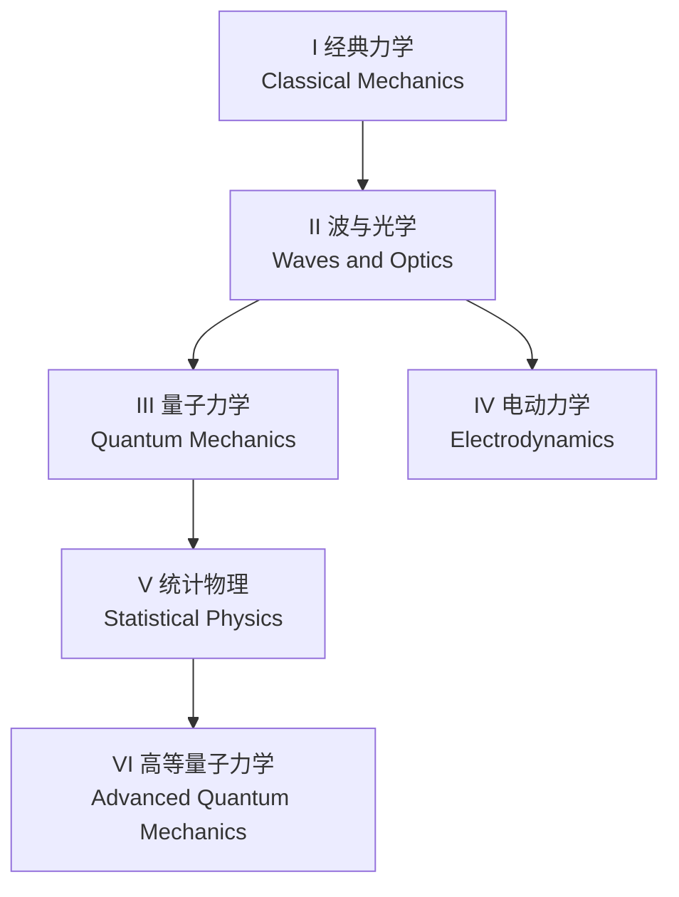

# 直抵前沿 · Frontier Bound

**在线阅读 · Read online:** <https://chenao-phys.github.io/booklets/>

写给物理初学者的六本互动手册。
Six interactive booklets for beginning physicists.

## 理念 · Principles

| | 中文 | English |
|---|---|---|
| **双语 Bilingual** | 中英对照，页面上一键切换。 | English and Chinese, switchable on every page. |
| **直观 Intuitive** | 以 HTML 呈现，配合动画与交互：先看见，再计算。 | Written in HTML with animations and interactions: see it first, then calculate. |
| **简洁 Simple** | 不堆砌文字，只讲要点。 | No padding — only what matters. |
| **数学 Mathematical** | 超出高中的数学，都在用到时循序渐进地教。 | Every bit of math beyond high school is taught step by step, when it is needed. |
| **计算 Computational** | 公式与软件并用，直抵前沿研究。 | Formulas and software together, straight to frontier research. |
| **练习 Practice** | 每章配海量习题，每次抽一组 10 题，答对 9 题即通过测试。 | Every chapter has a large problem bank; each test draws 10 problems, and 9 correct passes. |

## 书目 · Booklets

| # | 手册 Booklet | 前置 Prerequisites | 顺带学习的数学 Math taught inside |
|---|---|---|---|
| I | 经典力学 Classical Mechanics | — | 微积分 Calculus, 线性代数 Linear Algebra, 复数 Complex Numbers |
| II | 波与光学 Waves and Optics | I | — |
| III | 量子力学 Quantum Mechanics | II | 群论 Group Theory |
| IV | 电动力学 Electrodynamics | II | 偏微分方程 Partial Differential Equations |
| V | 统计物理 Statistical Physics | III | 数理统计 Mathematical Statistics |
| VI | 高等量子力学 Advanced Quantum Mechanics | V | — |

## 学习地图 · Learning Map



表格与地图只列出直接前置，更早的前置沿箭头往上追溯即可。
The table and the map list only direct prerequisites. Follow the arrows upward for earlier ones.

## 目录结构 · Structure

```
booklets/
├── index.html               # 首页与交互式学习地图 · Home page with the interactive map
├── README.md
├── assets/                  # 各册共用 · Shared by all booklets
│   ├── booklet.css          #   样式 · Styles
│   └── booklet.js           #   中英切换、KaTeX 公式 · Language switch, KaTeX math
├── classical-mechanics/     # 每本手册一个文件夹 · One folder per booklet
│   ├── index.html           #   本册目录 · Contents of the booklet
│   └── 01-describing-motion.html      # 第 1 章 · Chapter 1
├── waves-and-optics/
├── quantum-mechanics/
├── electrodynamics/
├── statistical-physics/
└── advanced-quantum-mechanics/
```

各册文件夹在开始编写时创建，入口为 `<folder>/index.html`（本册目录），章节文件命名为 `NN-<slug>.html`。
在 [index.html](index.html) 的 `BOOKS` 数组中把对应条目设为 `ready: true`，首页上的“开始阅读”按钮就会生效。
章节页面中，中英文内容分别写在 `lang="zh"` 与 `lang="en"` 的元素里，由 `assets/booklet.js` 切换显示。

Each booklet's folder is created when writing starts, with `<folder>/index.html` (its contents page) as the entry point; chapters are named `NN-<slug>.html`.
Set `ready: true` for that entry in the `BOOKS` array in [index.html](index.html) to turn on its "Start reading" button.
In chapter pages, put Chinese and English text in elements with `lang="zh"` and `lang="en"`; `assets/booklet.js` shows the active one.

## 本地浏览 · View locally

直接用浏览器打开 `index.html`，或启动一个本地服务器：
Open `index.html` in a browser, or run a local server:

```bash
python3 -m http.server 8000
# 然后访问 · then visit http://localhost:8000
```

## 进度 · Status

🚧 编写中 · Work in progress

- 第 I 册 经典力学：目录已建立，第 1 章待写。Vol. I Classical Mechanics: contents page in place, Chapter 1 not yet written.
